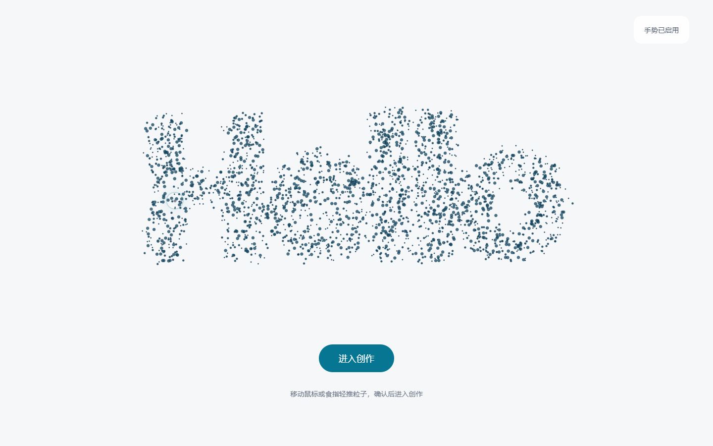
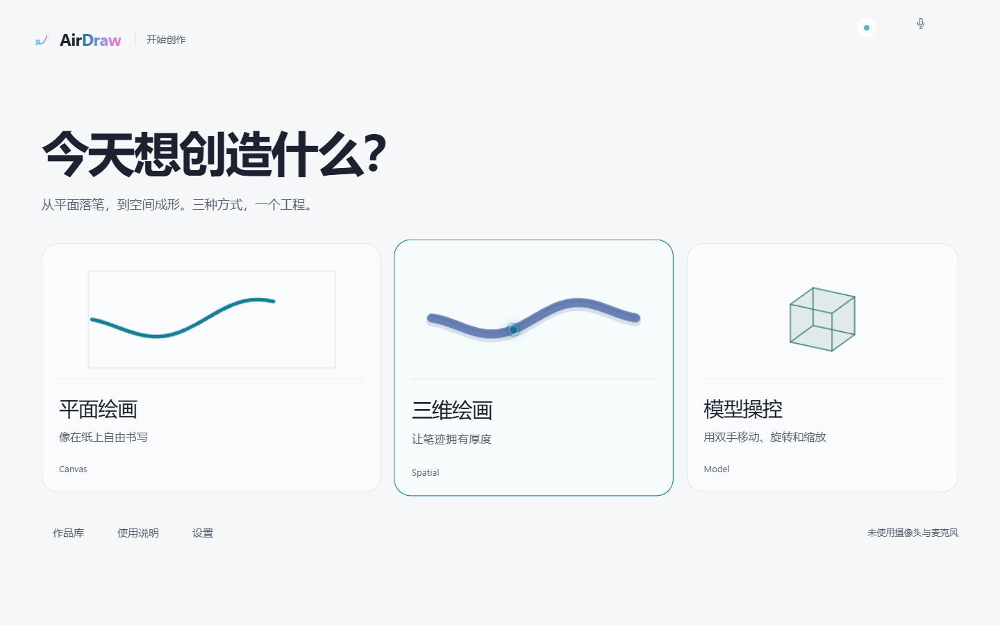
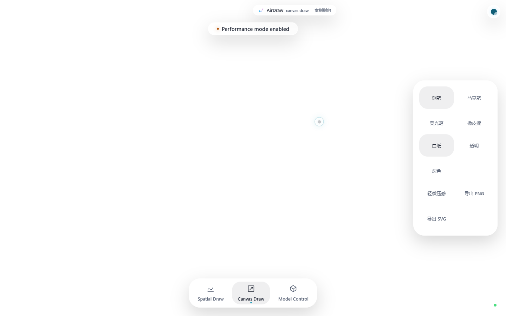
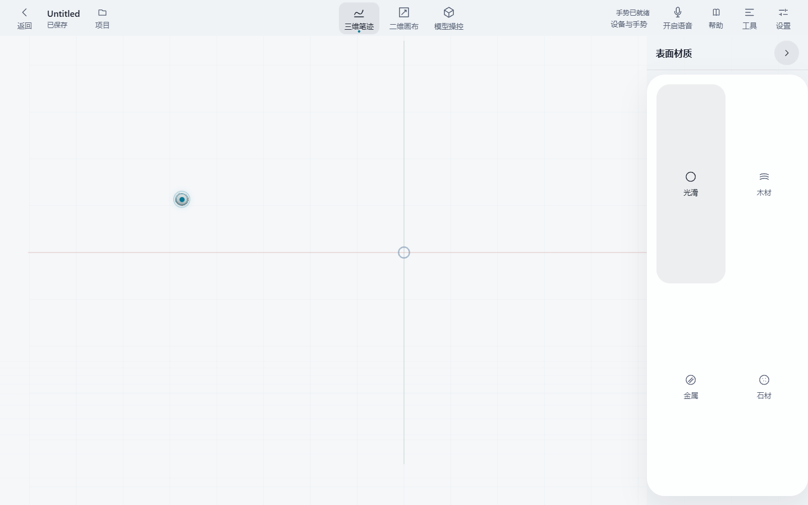
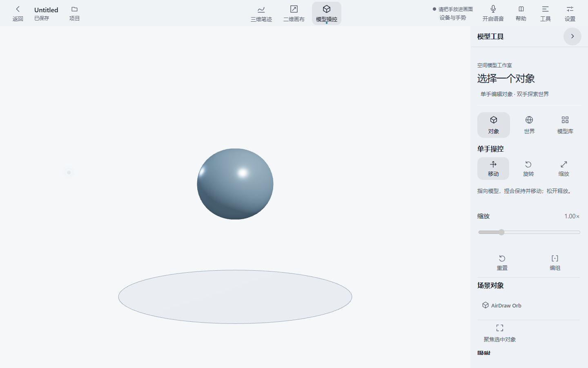
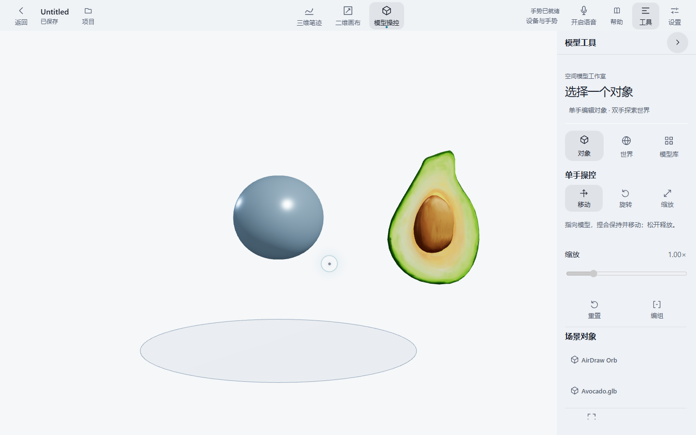

# AirDraw

**AirDraw** is a browser-based, camera-powered creative workspace for drawing in 2D and 3D, then arranging and manipulating 3D objects with hand gestures.

**AirDraw** 是一款基于浏览器摄像头的创作工作区：通过手势进行二维、三维绘画，并导入和操控 3D 模型。

体验：https://airdraw-c1m.pages.dev/
> Current scope / 当前功能：Spatial Draw, Canvas Draw and Model Control. PlayLab toys were removed from the current product. / 三维绘画、平面绘画与模型操控。互动玩具已从当前产品移除。

| Hello / 粒子开场 | Creation hub / 创作大厅 |
|---|---|
|  |  |

| Canvas Draw / 平面绘画 | Spatial Draw / 三维绘画 |
|---|---|
|  |  |

| Model Control / 模型操控 | Model library / 模型库 |
|---|---|
|  |  |

Screenshots use isolated browser runs and simulated input; they do not show or verify a live camera session. / 截图来自隔离浏览器和模拟输入，不含真人摄像头画面，也不代表实机验收。

## Documentation / 项目文档

- [中文使用指南](USER_GUIDE.md) · [English user guide](docs/USER_GUIDE_EN.md)
- [Bilingual quick-start tutorial / 中英快速入门](docs/QUICK_START.md)
- [Screenshot guide / 截图说明](docs/release/SCREENSHOTS.md)
- [Camera architecture / 摄像头架构](docs/camera-architecture.md)
- [Project data schema / 工程数据结构](docs/project-schema.md)
- [Latest development log / 最新开发日志](docs/phase21-log.md)

## Start locally / 本地启动

Requirements: Node.js 20+, npm and a current Chromium-based browser. Camera access requires localhost or HTTPS.
环境要求：Node.js 20+、npm 和现代 Chromium 浏览器；摄像头需要 localhost 或 HTTPS。

~~~
npm install
npm run dev
~~~

Open the local URL printed by Vite. Create a production build with npm run build and preview it with npm run preview.
打开 Vite 输出的本地地址。使用 npm run build 生成生产构建，使用 npm run preview 本地预览。

## Current features / 当前功能

- **Canvas Draw / 平面绘画** — smooth strokes, brush types, canvas backgrounds, undo/redo, PNG and SVG export. / 平滑笔迹、不同笔刷与背景，支持撤销重做及 PNG、SVG 导出。
- **Spatial Draw / 三维绘画** — smooth 3D strokes with a spatial grid and origin axes. / 平滑三维笔迹、空间网格与原点坐标轴。
- **Model Control / 模型操控** — hand-driven object move, rotate and scale; two-hand navigation of the 3D world; GLB/GLTF import. / 手势移动、旋转和缩放对象，双手导航三维世界，支持导入 GLB/GLTF。
- **Projects and export / 工程与导出** — local project save, autosave, gallery, JSON project package, PNG and WebM capture. / 本地保存、自动保存、作品库、JSON 工程包、PNG 与 WebM 导出。

## Status and limitations / 当前状态与限制

AirDraw is under active development. Automated and isolated browser checks do not replace real camera, hand, microphone, browser compatibility or hardware performance testing. Pointer/stroke drift after the hand becomes still remains an open real-device issue.
AirDraw 仍在持续开发。自动化与隔离浏览器检查不能替代真实摄像头、真人手势、麦克风、兼容性或硬件性能测试。手部静止后的光标/笔迹偏移仍是待实机验证的问题。

Camera frames and hand landmarks are processed in the browser. Browser speech recognition may rely on vendor online services; do not assume voice is offline. Projects are stored in browser storage; export AirDraw JSON to back up important work.
摄像头帧与关键点在浏览器中处理。语音识别可能依赖浏览器厂商的在线服务，不应默认视为离线。工程保存在浏览器本地，请导出 AirDraw JSON 备份重要作品。

## License / 许可证

There is currently no root-level project license. Until one is selected and added, all rights are reserved by default. Model attribution is documented in public/models/library/ATTRIBUTION.md.
项目当前没有根目录许可证文件。在明确选择并添加许可证前，默认保留所有权利。模型来源与授权见 public/models/library/ATTRIBUTION.md。

Development history is retained in [the phase logs](docs/phase21-log.md) and [the Phase 18 README archive](docs/README_PHASE18_ARCHIVE.md).

